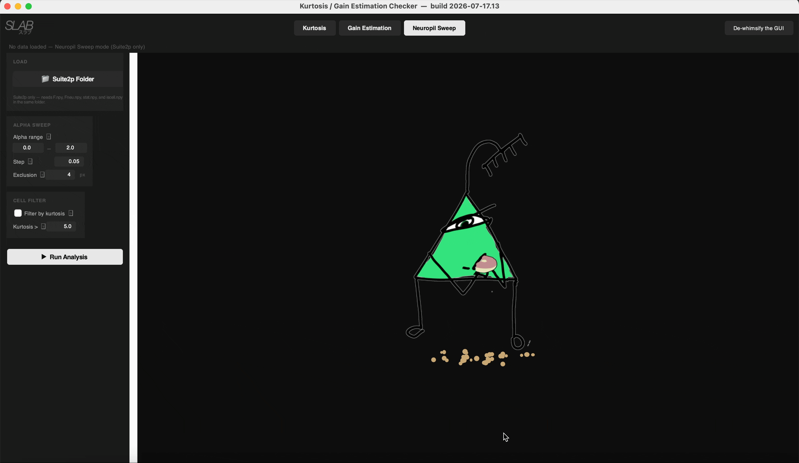
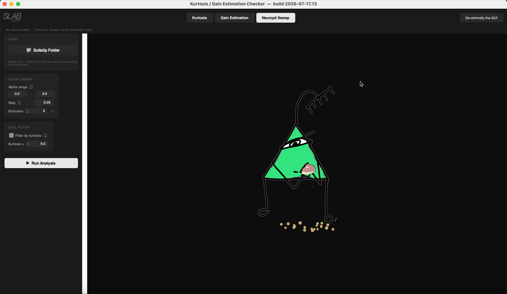

# Kurtosis / Gain Estimation Checker

A desktop tool for two-photon calcium imaging QC, built around Suite2p output. It has three modes, toggled from the top bar:

- **Kurtosis** — sorts and visualizes ROI traces by kurtosis or SNR to let the user assess whether one or the other can sort their data better
- **Gain Estimation** — runs a photon-transfer-curve analysis on a Suite2p recording to estimate PMT/camera gain (ADU/photon) and convert each cell's fluorescence to photons/cell/s. Option to use raw recordings that can be motion corrected (requires caiman package) and segmented.
- **Neuropil Sweep** — Suite2p only. Sweeps the neuropil-subtraction coefficient alpha (`Fcorr = rawF - alpha*Fneu`), plots the mean ± SEM pairwise cell-cell correlation at each alpha, and suggests alpha ranges for spike-train accuracy, precision, recall and true pairwise correlation from a ground-truth simulation.

## At a Glance

**Kurtosis** — sorts and visualizes ROI traces by kurtosis or SNR.


**Gain Estimation** — photon-transfer-curve gain estimate (ADU/photon) and per-cell photon flux.


**Neuropil Sweep** — sweeps the neuropil-subtraction coefficient alpha and plots the mean pairwise cell-cell correlation at each alpha.



## Director's cut demo

https://youtu.be/zqxz35iwyIM

## Installation

```
pip install numpy scipy matplotlib pillow tifffile
python kurtosis_checker.py
```

That's everything you need if you already have registered TIFFs saved (see Case 1 below). CaImAn is an optional, heavier dependency only needed if Suite2p's `reg_tif` export is missing (Case 2), if a Raw Movie needs motion correction, or if you choose CNMF segmentation. If `reg_tif` is missing and CaImAn/the raw TIFFs aren't available either, you can point the tool at Suite2p's own `data.bin` instead (see *Case 2b* below) — no extra dependency needed for that path. `h5py` is optional, only needed if you're loading a `.mat` movie saved in MATLAB's v7.3/HDF5 format.

## Interface

**Layout:** the Gain Estimation and Neuropil Sweep tabs each have an always-visible left sidebar (Load buttons, then settings grouped into rounded-corner cards, then Run Analysis), scrollable independently once its cards outgrow the window height. The Kurtosis tab has a top-bar Load Data + collapsible Settings, plus a **▶ Plot** button. Every sidebar parameter has a small "?" glyph next to it — click it to toggle a popup explaining what the setting does.

**De-whimsify the GUI:** a button at the far right of the top bar, visible on every tab. Click it and every 'creative' 100% not ai generated animation in the app is removed or replaced with a generic loading bar. I did go a little bit overboard. If you want it to go away that's totally fair. But if you change your mind just click again to bring all the whimsy back.



**Character "art":** the artwork is hand-drawn, rasterized from vector source files and embedded directly in `kurtosis_checker.py` as base64 PNG data — no separate `art/` folder is needed to run the app. 

**PTC reference citation:** the Gain Estimation sidebar's Export card links directly to the Lees et al. 2025 photon-transfer-curve reference protocol citation, with the DOI as a clickable link. (See Box 8 and Fig.16).


## Gain Estimation: two setup cases

Click **Gain Estimation** in the top bar, then in the left sidebar's **LOAD** card click **📁 Suite2p Folder** and select any folder at or above your Suite2p output. The tool recursively searches *downstream* of whatever folder you select for a directory containing `ops.npy` — there's no fixed list of expected folder names, so it works whether you're parked at the session folder, a custom intermediate folder, the `suite2p` folder, or `plane0` itself directly.

If the tree contains **more than one** `ops.npy`, the search prefers whichever one has a *usable* `reg_tif` export over one that doesn't, rather than just grabbing the first/shallowest match.

### Case 1 — You have registered TIFFs saved (recommended, no CaImAn needed)

If you ran Suite2p with the `reg_tif` option enabled, your plane folder has a `reg_tif/` subfolder containing the motion-corrected movie as TIFF chunks (e.g. `file000_chan0.tif`, `file001_chan0.tif`, ...). This is the tool's preferred source and requires nothing beyond the core dependencies above.

1. **Suite2p Folder** → select the folder. The status bar shows the full resolved path plus a `reg_tif found (N file(s))` / `no usable reg_tif` hint.
2. Click **Run Analysis** (bottom of the sidebar).
3. The tool reads only the chunk files it needs for a contiguous window of frames (see *Memory behavior* below), computes the PTC gain fit, and shows:
   - Left panel: the Photon Transfer Curve (mean vs. variance, shot-noise fit)
   - Right panel: per-cell photon flux histogram (median)

**Notes:**
- Suite2p's own `data.bin` binary is never used *automatically*, even if present — it's a scratch/working file Suite2p can overwrite on a later run (e.g. a subsequent re-run, or when processing other planes), so it isn't a guaranteed match for the currently-loaded `F.npy`. If there's no `reg_tif` export, the tool goes straight to Case 2. Only if Case 2 turns out not to be available (see *Case 2b*) will you be asked whether to use `data.bin` instead — and only after an explicit confirmation dialog.
- File matching inside `reg_tif/` is case-insensitive and doesn't require `chan0` in the filename. If a `reg_tif/` folder exists but has no readable TIFFs inside it, the tool raises an error listing that folder's contents. If you have multiple channels maybe copy them out to a separate file. Or email me. If this video gets 10 likes I will add the channel selection option.

### Case 2 (optional) — You don't have motion-corrected TIFFs saved

If `reg_tif` wasn't exported, the tool falls back to the raw acquisition TIFFs and motion-corrects them on the fly using **NoRMCorre**, via **CaImAn**.

Install CaImAn (compiled dependencies mean mamba/conda is the supported route — plain `pip install caiman` is not):

```
conda install -n base -c conda-forge mamba
mamba create -n caiman caiman
conda activate caiman
```

Windows note: if `conda install` fails with `SSL module is not available`, that's a broken/mismatched OpenSSL DLL pairing, not a real certificate problem. Try the [fix-conda-ssl](https://github.com/davidfokkema/fix-conda-ssl) tool, or do a clean Miniforge/Miniconda reinstall if the manual fix doesn't resolve it.

Once CaImAn is installed:

1. **Suite2p Folder** → select the folder. The status bar shows `no reg_tif export — will need NormCorre on raw TIFFs`.
2. Click **Run Analysis**. The tool tries to resolve the raw TIFF paths from `ops.npy` automatically; if those paths don't exist on this machine, it will prompt you to locate the raw TIFF folder manually.
3. NoRMCorre runs (rigid by default; enable **piecewise-rigid** in the sidebar's MOTION CORRECTION card for non-rigid correction), then the PTC analysis proceeds as in Case 1.

**Saving the motion-corrected movie:** the **"Save motion-corrected TIFF (reg_tif)"** setting (checked by default) writes the NormCorre output as `reg_tif/file000_chan0.tif`-style chunks next to the source data, matching Suite2p's own naming convention. Next time you load the same folder, the tool finds this `reg_tif/` export and uses it directly.

### Case 2b (fallback) — No `reg_tif`, and NormCorre isn't available either

If there's no `reg_tif` export AND raw-TIFF motion correction isn't an option right now — CaImAn isn't installed, or the raw acquisition TIFFs can't be located automatically and you don't have (or don't want to point at) a raw-TIFF folder — the tool offers one more option before giving up: Suite2p's own `data.bin`, the registered binary Suite2p itself writes into the plane folder during its own run.

This is opt-in every time, never automatic. When offered, a dialog explains the risk plainly: `data.bin` is a scratch/working file that Suite2p can silently overwrite on a later run, so it's only trustworthy if you're confident nothing has re-run Suite2p on that folder since the `F.npy` you're using was produced. You then either confirm the auto-detected `data.bin` next to `ops.npy` (or pointed at by `ops['reg_file']`), or browse to a different one — e.g. a copy you saved off before a re-run.

Frame shape (`Ly`/`Lx`) is read from `ops.npy` (required — `data.bin` is a headerless raw binary), but the frame *count* is derived from the file's own size rather than trusted from `ops['nframes']`, since `ops.npy` can be just as stale as `data.bin` if the folder was copied or moved. If the two disagree, that mismatch is called out in the run's source note rather than silently picking one.

`data.bin` loaded this way is treated exactly like a `reg_tif` export downstream — same PTC fit, same segmentation options (CNMF / Manual ROIs / Skip) if there's no `F.npy` — the only difference is the results panel and export files label its source as `data_bin` with an "UNVERIFIED" note, as a standing reminder of the staleness risk above.

**Cell segmentation when there's no `F.npy`:** any time there's no `F.npy` available for the loaded dataset — Case 2, the Raw Movie flow below, or the no-Suite2p fallback further down — the tool asks how to fill the photon-flux panel, with three choices: run CaImAn **CNMF** on the registered movie to detect cells and extract traces automatically; draw **Manual ROIs** yourself; or **Skip** and leave the flux panel empty (the gain estimate itself doesn't need cell traces).

Right before that choice, the tool shows a zoomable/pannable **mean-projection viewer** of the just-loaded registered movie, so you can count how many pixels a cell spans. It then asks directly for the cell diameter (px), converts it to a radius, and writes it into the **"CNMF cell radius (px)"** setting.

**CNMF:** fills the flux panel using CNMF-derived footprints; the results panel labels these cells "CaImAn CNMF (unverified — sanity-check!)" as a reminder to check footprints/traces before trusting the numbers. The **"CNMF cell radius (px)"** setting (default 6) controls the expected cell size (`gSig`) passed to CNMF. After CNMF finds candidate components, the tool calls CaImAn's own `evaluate_components()` and keeps only the top 60% by whichever quality score that produces — CaImAn's CNN-classifier probability if a CNN model is installed and usable, otherwise the `r_value` spatial-consistency score as a fallback. If quality evaluation isn't available at all, all components are kept.
Note: CNMF might run for a while. I was considering adding cellpose, but we already have CaImAn from motion correction and I want to keep the number of dependencies minimal. I do like cellpose though. 

**Manual ROIs:** opens a polygon-drawing tool over the same mean projection — click to place points, click the first point again (or press Enter) to close the polygon, then **Add ROI** to glue it on and start the next one, and **Done** when finished. Each banked polygon becomes a cell, with its photon flux computed the same way as every other path: an unweighted sum of raw pixel values over the ROI mask. Results are labeled "Manual ROIs (user-drawn)" in the flux panel.

A **footprint sanity-check popup** shows the mean projection with the resulting masks outlined in green (and, for CNMF, the quality-filtered-out ones in red) — non-blocking, with the same zoom/pan toolbar as the mean-projection viewer, for both CNMF and Manual ROIs.

The animation runs on Tk's main-thread event loop (~30fps) while the actual PTC/segmentation computation runs in a separate background thread. That doesn't mean the animation isn't slowing down the compute time, but it is so worth it. An "Estimating gain" title sits directly above the animation while it's running.

### Raw Movie — load a TIFF, .mat, or .npy movie directly


The **"🎬 Raw Movie"** button (in the sidebar's LOAD card, next to Suite2p Folder) loads a movie straight from a file instead of a Suite2p folder. It asks two questions:

1. **Already motion corrected, or raw?** "Already motion corrected" loads the movie as-is and skips NormCorre entirely — useful when motion correction was already done somewhere else (e.g. in MATLAB), or when NormCorre keeps failing with `OSError: [Errno 28] No space left on device`. "Raw — needs motion correction" runs it through the same NoRMCorre/CaImAn pipeline as Case 2, exactly as if it were a manually-selected raw TIFF folder — for a raw `.mat`/`.npy` source, the movie is first written out to temporary TIFF chunk files so it can go through that same pipeline unchanged.
2. **File format:** TIFF, `.mat`, or `.npy`.

For `.mat` files, both classic (pre-v7.3) and v7.3/HDF5 formats are supported (the latter needs `pip install h5py`); the expected matrix shape is **(x, y, time)**, MATLAB's own `size(mov)` convention, and if the file has more than one 3D array in it, the largest one is picked automatically. For `.npy` files, the array is expected already shaped **(time, y, x)** — numpy's own natural frame-stacking order, no axis transpose applied. Either way, a confirmation dialog shows the detected shape before committing.

The **"Scratch folder"** setting in the sidebar's MOTION CORRECTION card (click **"📁 Choose…"**, or **"Reset"** to go back to CaImAn's default) points NormCorre's memmap writes at a folder on a drive with more room, for the disk-space case above.

A Raw Movie load has no Suite2p `F.npy` of its own, so right after it loads you're asked whether you already have a Suite2p run's `F.npy`/`stat.npy` for this same recording (e.g. Suite2p was run without the `reg_tif` export option checked) — attaching one fills the photon-flux panel directly. If you skip that (or don't have one), it falls back to the same three-way segmentation choice (CNMF / Manual ROIs / Skip) described above.

### No Suite2p output at all

If the selected folder has no `ops.npy` anywhere, the tool offers to run the PTC gain estimate directly on manually-selected TIFF file(s), bypassing Suite2p entirely. A **"Skip motion correction"** setting lets you tell it the TIFF is already registered, avoiding an unnecessary NormCorre pass. This path also has no `F.npy`, so it goes through the same three-way segmentation choice (CNMF / Manual ROIs / Skip) described above.

## Memory behavior

Gain Estimation mode is deliberately conservative about RAM as it kept crashing my laptop:

- The registered movie is only loaded when you click **Run Analysis** — never on folder load, never on tab switch.
- Above ~1.5 GB estimated usage, a confirmation dialog shows the estimate before loading anything.
- For chunked `reg_tif` exports, only the chunk files overlapping the needed frame window are decoded.
- Frame subsampling (`Max frames` setting) always picks a contiguous window of frames, not evenly-spaced samples. By default that window is auto-centered on the recording; the **"Start frame"** setting lets you pin it to an explicit starting index instead.
- `reg_tif`/raw-TIFF arrays are kept in their native dtype (typically int16) rather than eagerly upcast to float32; the PTC computation streams frame-pairs in chunks so peak memory doesn't scale with total recording length.
- The raw movie array is dropped from memory immediately after the PTC bins are computed.
- Spatial binning is possible to reduce size, but is set to 1 by default (no binning).

## Key settings (Gain Estimation)

| Setting | Default | Meaning |
|---|---|---|
| ENF | 1.2 | Excess noise factor (GaAsP PMT); `gain_true = slope / ENF²` |
| Fit range (pct of mean) | 0–50 | Which intensity-percentile bins are used for the shot-noise linear fit. Matches the Lees et al. 2025 reference protocol's default (lower half of the intensity range only). Raise the high end toward 98 to use (almost) the full range instead — see *PTC method notes* below. |
| Spatial bin (px) | 1 | Superpixel binning before the PTC fit (summed, not averaged — gain estimate is invariant to this setting) |
| Max frames | 2000 | Size of the contiguous frame window used for the PTC estimate |
| Start frame | blank (auto-center) | Explicit starting frame index for that window; blank keeps the auto-centered behavior |
| Edge margin (px) | 4 | Crops this many pixels off every edge of each frame before computing anything, to exclude blanking/vignetting artifacts near the frame border (see *PTC method notes* below). Matches the Lees et al. 2025 reference protocol's own default; set to 0 to disable cropping entirely. |
| Exclude cell ROIs | off | Restrict the PTC fit to background/non-cell pixels only |
| NormCorre: piecewise-rigid | off | Use non-rigid motion correction instead of rigid (Case 2 only) |
| Use data.bin (Case 2b, opt-in) | -- | Offered only when `reg_tif` is missing and NormCorre isn't available; always requires an explicit confirmation dialog, never used silently |
| Skip motion correction | off | Manual-TIFF mode only — skip NormCorre if the TIFF is already registered |
| Save motion-corrected TIFF (reg_tif) | on | After NormCorre runs, save the result as `reg_tif/` chunks next to the source so future runs skip motion correction entirely |
| CNMF cell radius (px) | 6 | Expected cell radius (`gSig`) passed to CaImAn CNMF, used only when it's offered to fill an empty flux panel after a fresh NormCorre run |
| Use baseline (F0) for flux | on | Converts each cell's own low-percentile baseline value directly to photons/s, instead of the trace's plain mean |
| Baseline pctile | 30 | Which percentile of each cell's own raw trace counts as its baseline (F0) when the above is checked |

Photon flux uses **raw F only** — no neuropil subtraction — consistent with the Wilt et al. (2013) convention that F0 includes all detected photons (signal + background light). F itself is never modified for the flux calculation; what changes is which per-cell scalar gets converted to photons/s. With **Use baseline (F0) for flux** unchecked, that's the plain per-frame mean of the whole trace. Checked (the default), it's each cell's own baseline — the `Baseline pctile`-th percentile of its raw trace — converted directly.

Both Suite2p's `F.npy` and CaImAn CNMF traces are put on a comparable per-cell-total scale before this conversion, but they get there differently: CNMF traces (via `footprints_to_raw_traces`) are already a true unweighted pixel sum over each ROI mask. Suite2p's `F.npy` normalizes its per-pixel ROI weights (`lam`) to sum to 1 before extraction, so it's actually a weighted mean pixel value. The Suite2p loader corrects for this at load time by multiplying `F` (and `Fneu`) by each ROI's pixel count (`npix`, from `stat.npy`), recovering a per-cell total that matches the CNMF path's convention.

**Re-fit without a full re-run:** after Run Analysis has completed once, the **↻ Re-fit** button (under Fit range/ENF in the sidebar) redoes just the linear PTC fit — and, if there's a flux panel, rescales it — using the mean/variance bins already computed. It's instant (no thread, no movie re-read). Frame rate `fs` is also picked up live by Re-fit. Spatial bin, Edge margin, Exclude cell ROIs, and anything CNMF/motion-correction related bake into the bins themselves during the raw-pixel pass, so changing those still needs a full Run Analysis.

## Exporting results for cross-condition comparison

Once Run Analysis has completed, the **💾 Export Results…** button (EXPORT card in the sidebar, just above Run Analysis) writes the current run's numbers to disk so results from different conditions/sessions/animals can be loaded into one table and plotted against each other outside the app. Clicking it asks for a short label for this run and a destination folder, then writes:

- **`gain_results_summary.csv`** — one row per export, appended across calls: timestamp, label, source, cell count, `gain_true`/slope/intercept/r², flux median ± SEM, and every sidebar setting that affected the run.
- **`{label}_{timestamp}_ptc_bins.csv`** — that run's PTC mean/variance bins (`mu_bin`, `var_bin`, `n_bin`, and whether each bin was used in the fit), enough to redraw the hockey-stick plot exactly.
- **`{label}_{timestamp}_flux_percell.csv`** — one row per cell's photon flux, only written if that run had a flux panel at all.

The summary row records each detail file's name, so a given condition's summary row can always be matched back to its own bins/flux files.

## Neuropil Sweep

The third tab, Suite2p-only (needs `F.npy`, `Fneu.npy`, `stat.npy`, and `iscell.npy` in the same folder — no registered movie, NormCorre, or CaImAn involved at all). Click **📁 Suite2p Folder** in its sidebar's LOAD card, then **Run Analysis**.

**What it does:** sweeps the neuropil-subtraction coefficient alpha across a configurable range (default 0–2, step 0.05) in `Fcorr = rawF - alpha*Fneu`, and at each alpha computes the mean ± SEM of the off-diagonal pairwise Pearson correlation between cells (only cells with `iscell == 1`). The dashed line marks the minimum of that curve, which serves as the anchor for the suggested ranges below (not as a recommendation itself).

**Exclusion distance (default 4px):** cells whose ROI mask comes within this many pixels of the FOV border are dropped from the sweep entirely. Distance is the exact nearest-pixel (edge-to-edge) gap between the ROI's `stat.npy` pixel mask and the frame edge (using `ops.npy`'s `Ly`/`Lx`), not centroid-to-centroid — cells right at the edge of the field of view can have a clipped/incomplete neuropil ring, biasing `Fneu` the same way at every alpha.

**Cell filter (optional):** the **"Filter by kurtosis"** checkbox restricts the sweep to cells with Pearson kurtosis (`fisher=False`, normal ≈ 3) above a threshold (default 5), computed on the raw, un-subtracted trace before anything else runs.

The sidebar's alpha range/step and exclusion-distance fields, and the kurtosis-filter checkbox/threshold, are the only settings — see `neuropil_alpha_sweep`, `build_border_exclusion_mask`, and `roi_border_distance` in `kurtosis_checker.py` for the implementation.

**Suggested alpha ranges.** The alpha at the minimum of the sweep is *not* recommended: it assumes the cells' real activity is uncorrelated with the neuropil, so it is pushed up whenever the population is correlated, and by each cell's own light leaking into its neuropil ring. It is still useful as an anchor: more contamination moves the minimum and every optimal alpha by about the same amount (exactly so if the extra contamination were k·Fneu, since F + k·Fneu − alpha·Fneu = F − (alpha − k)·Fneu; approximately in practice, because each cell's own light and the noise in Fneu do not scale with contamination — in the simulation grid the offsets stayed within ~0.1–0.2 across contamination ×0.7–1.3), so the distance from the minimum to an optimum depends little on the unknown contamination. The tab reports, for four goals, a range of alphas measured from the minimum using offsets from a ground-truth simulation (Allen Huang et al. 2021–calibrated traces, OMSI spike inference, scored against the true spikes):

- **Spike-train accuracy** — COSMIC-style triangular-kernel correlation (0.5 s half-width) between inferred and true spikes
- **Precision** and **Recall** — spike matching within ±100 ms
- **True pairwise correlation** — mean pairwise correlation of inferred spike counts (1 s bins) equal to the truth

The bright bar is the spread of the best alpha across the simulated correlation levels (the recording's true correlation is unknown); the pale bar is the near-optimal band (within 5% of best; for the last goal, inferred correlation within 25% of the truth, at least 0.01).

**Costs of each alpha (exact, no simulation).** A strip under the sweep shows, from your own traces: the frame-to-frame noise SD of F − alpha·Fneu relative to raw F (median and IQR over cells — subtracting adds the ring's own noise), and the percentage of cells whose baseline F0 (8th percentile of F − alpha·Fneu) is ≤ 0. Alphas at which at least 10% of cells have F0 ≤ 0 are shaded red; there, dF/F and any F0-normalised spike inference are undefined for those cells.

**Shaded interval and examples.** The suggested range for the goal picked under *SHADED INTERVAL* in the sidebar is shaded on the sweep (dark: best, pale: near-optimal). Click anywhere on the sweep to pick that alpha step: a window opens with three example cells — at the 90th, 50th and 10th percentile of kurtosis among the cells used — showing raw F and Fneu (left) and F − alpha·Fneu (right) with its baseline F0 (8th percentile; red when ≤ 0) and, if `spks.npy` is present, OASIS events above 2× the noise SD. Its ◀ / ▶ buttons step through the sweep's alphas.

The panel also lists simulation-wide absolute values (median and middle half over all simulated conditions and correlation levels): spike-train accuracy 0.60 (0.50–0.80), precision 1.00 (0.90–1.10), true correlation 0.95 (0.88–1.00), and a single default pooled over those three of 0.90 (0.70–1.00). These are absolute alphas, so they hold only for contamination similar to the Allen 2× GCaMP6s recordings the simulation is built on.

The tab also reports recording statistics (median over cells): neuropil fluctuation size (SD of Fneu/median after 1 s smoothing), noise SD / mean F, mean Fneu / mean F, and — if `spks.npy` is present — OASIS event rate and how much of a cell's own transient appears in its ring. Neuropil fluctuation size and noise pick the closest simulated conditions in `alpha_calibration.json`, which ships next to `kurtosis_checker.py` (11 simulated conditions: baseline; contamination ×0.7/×1.3; neuropil fluctuation, noise and firing rate ×0.5/×2; own light in the ring ×0/×2). The ring ratio is shown but not used for matching yet: it moves the best spike-train alpha most, but the calibration measured it at the true spikes and it still needs checking against OASIS-detected events on real recordings. Conditions the statistics cannot tell apart (e.g. contamination, firing rate, own light in the ring) are pooled, so their spread widens the range. Rebuild it with `tools/build_alpha_calibration.py --grid <folder>`. Without the file, a built-in baseline-only table is used and the suggestions are marked **provisional**. In a leave-one-condition-out test the true best alpha fell inside the suggested near-optimal range in 55/55 cases for spike-train accuracy and inside the bright "best" range in 48/55; the ranges are wide (median ~0.65) because the true population correlation, and how much of each cell's light reaches its ring, are hard to pin down from the data.

## PTC method notes (vs. the Lees et al. 2025 reference protocol)

Checked against a MATLAB reference implementation of the Lees et al. 2025 (*Nature Protocols*, Procedure 7 / Box 7-8) method. The core statistics match exactly: adjacent-frame mean `M = 0.5*(X + X')`, adjacent-frame variance `D = 0.5*(X - X')²` (averaged per-pixel over all frame pairs, so slow structural signal cancels and only shot noise survives), and the `gain_true = slope / ENF²` correction are identical formulas in both.

- **Edge cropping:** the reference protocol crops a fixed margin off every frame edge before computing anything, to exclude blanking/vignetting artifacts that resonant-scan two-photon systems can have near the frame border. The **"Edge margin (px)"** setting matches this — default 4px, matching the reference protocol's own default; set to 0 to disable.
- **Fit-range default:** matches the reference protocol's lower-50%-of-intensity-range default (`Fit range (pct of mean)` = 0–50) — raise the high end toward 98 per-run if you want the wider range instead.
- **Binning:** the reference protocol bins by unique rounded ADU value (mean-aggregated, weighted by `sqrt(pixel count)`). This tool bins into 40 percentile-spaced bins instead (median-aggregated, weighted by raw pixel count — standard weighted least squares). Both are defensible; median binning is more robust to localized artifact pixels.

## Repo contents

- `kurtosis_checker.py` — the app (single file, tkinter + matplotlib). Fully self-contained: all embedded artwork and the slab wordmark logo are base64 PNG data inside this file, so there's nothing else to copy alongside it.
- `art/` — the source PNGs the embedded art data was generated from. Not needed to run the app; keep around only if the art ever needs regenerating.
